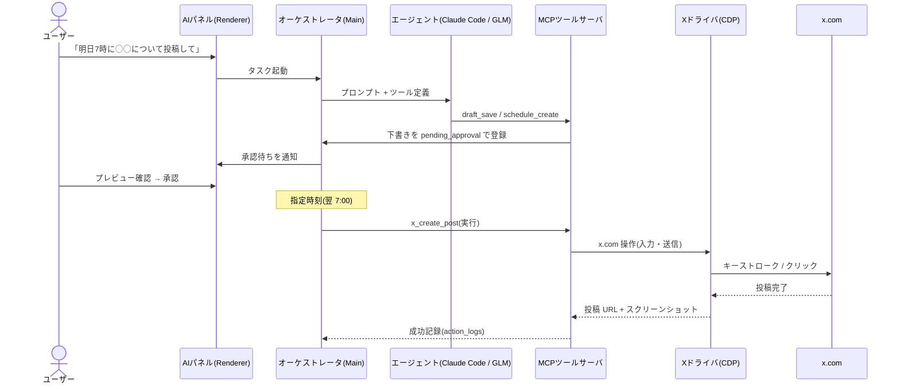

# mixbrowser 製品仕様(ドラフト v0.1)

- ステータス: **ドラフト(レビュー待ち)**
- 作成日: 2026-11-10
- 関連ドキュメント: [アーキテクチャ](architecture.md) / [ロードマップ・オープン課題](roadmap.md)

## 1. 背景と目的

X(旧Twitter)での情報発信(通常投稿・スレッド・画像付き投稿・予約投稿)を継続的に行う運用コストを下げたい。
X 公式 API は有料プランが高価なため、本プロジェクトでは **X との連携を公式 API に頼らず、実際のブラウザ操作として実現する** 方針を採る。

その実行基盤として、Chromium をエンジンに持つ **AI 連携専用ブラウザ「mixbrowser」** を構築する。
Claude Code / GLM などの AI エージェントをブラウザ内から直接利用でき、X の画面を実際に見ながら投稿文の生成・予約・実行までを 1 つのアプリで完結させる。

> **ゴール:** 「X アカウントでの自動投稿運用を、API コストなし・ブラウザ操作で・AI エージェントと協調しながら効率化する」

## 2. 用語

| 用語 | 定義 |
|---|---|
| プロファイル | X アカウント 1 件に対応する、分離されたブラウザストレージ(cookie / localStorage 等) |
| ドライバ | x.com をブラウザ操作(CDP)により動かす実行モジュール |
| エージェントランタイム | Claude Code CLI / GLM(OpenAI 互換 API)など、LLM エージェントを動かす実行系 |
| MCP | Model Context Protocol。本アプリがエージェントへ「ブラウザ操作ツール」を提供するための標準プロトコル |
| 承認ゲート | 自動実行の前に人間が内容を確認・承認する必須ステップ(既定 ON) |
| ドライラン | 投稿送信の直前で停止し、入力済み画面のプレビューとスクリーンショットのみを返すモード |

## 3. スコープ

### 3.1 In scope

1. Chromium ベースのブラウザシェル(通常の Web 閲覧も可能。専用機能はサイドパネル UI で提供)
2. X アカウントのプロファイル管理(複数アカウント、セッション保持、ストレージ分離)
3. ブラウザ自動化による X 投稿(単発 / スレッド / 画像添付 / 予約投稿)
4. AI エージェント連携: Claude Code(MCP)、GLM(OpenAI 互換 API)、Muse(Meta)はアダプタで抽象化(詳細未確定 → [オープン課題 Q1](roadmap.md))
5. 下書き・キュー・スケジュール管理 UI
6. 承認ゲート(人間確認)と実行ログ・証跡

### 3.2 非目標(Non-goals)

- **X 公式 API の利用**(本プロジェクトの前提として除外)
- DM 自動送信、自動フォロー / アンフォロー、大量リプライなど成長ハック系の自動化
- Meta 系サービス(Facebook / Instagram / Threads)画面の自動操作(将来の拡張候補。ドライバ抽象化により対応可能にしておく)
- 高機能な投稿分析ダッシュボード(M3 以降で検討)

## 4. 全体ユーザーフロー

1. ユーザーが mixbrowser を起動し、内蔵ブラウザで x.com にログインする(初回のみ手動。セッションは暗号化して永続化)
2. AI パネルで自然言語で指示する(例: 「明日の朝 7 時に ◯◯ について投稿して」)
3. オーケストレータがエージェント(Claude Code / GLM)を起動し、MCP 経由でブラウザツールを使用させる
4. 生成された投稿は **下書きキューに pending_approval 状態で登録** される
5. ユーザーがプレビューを確認して承認(承認ゲート、既定 ON)
6. スケジューラが指定時刻に X ドライバを起動し、Chromium 上で x.com を操作して投稿
7. 投稿 URL・スクリーンショット・実行結果をアクションログに記録

## 5. 機能要件

### FR-1 プロファイル / アカウント管理

- FR-1.1 アカウントごとに独立したブラウザプロファイル(cookie / localStorage を完全分離)
- FR-1.2 初回ログインは内蔵ブラウザで手動実施。以後セッションを暗号化永続化([NFR-1](#6-非機能要件))
- FR-1.3 セッション失効を検出し、再ログイン導線を UI で提示
- FR-1.4 (v2 検討) プロキシ設定のアカウント単位紐付け

### FR-2 AI コネクタ

- FR-2.1 **Claude Code 連携**: MCP サーバ経由でブラウザ操作ツールを提供。バッチ実行(headless `claude -p`)と対話実行(AI パネル)の両方に対応。認証はユーザー自身の Claude Code セットアップを利用
- FR-2.2 **GLM 連携**: OpenAI 互換 API + function calling で FR-2.1 と同一のツール群を使用
- FR-2.3 **コンテンツ生成ソースのアダプタ**(ContentGenerator IF): Claude Code / GLM / Muse を同一インターフェースで扱う。Muse は情報確定までスタブ実装
- FR-2.4 **AI パネル**: チャット UI から「生成 → キュー追加 → 予約」までを自然言語で指示可能

### FR-3 X 投稿エンジン(ブラウザ操作)

- FR-3.1 新規投稿: テキスト(280 字)/ スレッド(連結投稿)/ 画像 1〜4 枚添付
- FR-3.2 実行情報の記録: 投稿 URL、スクリーンショット、タイムスタンプ
- FR-3.3 **ドライランモード**: 送信直前で停止し、入力済み画面のプレビューを返す(自動実行時の既定)
- FR-3.4 失敗分類: セッション失効 / DOM 構造変更 / レート抑制 / その他 → リトライ方針を変える([roadmap リスク表](roadmap.md))

### FR-4 予約・キュー管理

- FR-4.1 下書きキュー(状態: `draft → pending_approval → scheduled → posting → posted / failed / canceled`)
- FR-4.2 予約投稿(タイムゾーンはローカル時刻)
- FR-4.3 **連投抑制**: アカウントごとに最小投稿間隔・日次上限を強制(設定可能、既定は安全側)

### FR-5 承認ゲート

- FR-5.1 既定 ON: すべての投稿は `pending_approval` を経由し、UI で承認した場合のみ実行
- FR-5.2 全自動実行モードは明示的なオプトイン + 日次上限 + 対象アカウントの明示指定を必須とする

### FR-6 ログ・監査

- FR-6.1 全自動操作のアクションログ(実行者 / いつ / 何を / 結果 / スクリーンショット)
- FR-6.2 ログ保持期間の設定(既定 90 日)

### FR-7 設定

- FR-7.1 エージェント設定(Claude Code のパス、GLM endpoint / API key、モデル名)
- FR-7.2 投稿安全設定(最小間隔、日次上限、実行許可時間帯)

## 6. 非機能要件

| ID | 要件 |
|---|---|
| NFR-1 | セキュリティ: cookie / セッションは OS キーチェーン(macOS Keychain / Windows DPAPI / libsecret)で管理。プロファイル間はプロセス・ストレージ双方で分離 |
| NFR-2 | プライバシー: テレメトリ無し。外部送信はユーザーが設定した LLM エンドポイントのみ |
| NFR-3 | 信頼性: キューは永続化し、クラッシュ時も失わない。全自動操作に証跡(スクショ)を残す |
| NFR-4 | パフォーマンス: 投稿 1 件の自動実行は 30 秒以内(画像込み 60 秒以内) |
| NFR-5 | メンテナンス性: セレクタはレジストリで一元管理。観測は DOM 生文字列ではなくアクセシビリティツリーを第一選択とし、x.com の表示変更に強くする |

## 7. 法務・コンプライアンス(重要)

- X の利用規約・自動化に関するルールは、無認可の自動投稿を禁止しており、検知された場合はロック / 凍結の対象になり得る。**本方式(API 不使用のブラウザ操作)はこのリスクを内包する。**
- 緩和策:
  1. 承認ゲート既定 ON(人間が全投稿を確認)
  2. 低頻度・人間らしい操作(実キー入力イベント + 間隔のランダム化)
  3. 日次投稿上限(既定は安全側の小さい値)
  4. headless にしない(実ブラウザ画面で動作)
  5. 1 アカウントの同時実行は 1 件まで(直列実行)
  6. 初回起動時に規約リスクへの同意画面を表示
- ただしリスクをゼロにはできない。利用はユーザー自身の判断と責任とする。
- コンプライアンス最優先の場合の代替案: X API 有料プランの利用。ドライバ抽象化は「公式 API ドライバ」の追加も許容する設計にする。

## 8. UI 概要

- 3 ペイン構成:
  - 左: アカウント / プロファイル一覧、ステータス
  - 中央: 内蔵ブラウザ(x.com 等を実際に表示)
  - 右: AI パネル(チャット)+ 下書きキュー / スケジュール
- キュー詳細: 投稿プレビュー(メディア込み)、承認 / 却下 / 時刻変更
